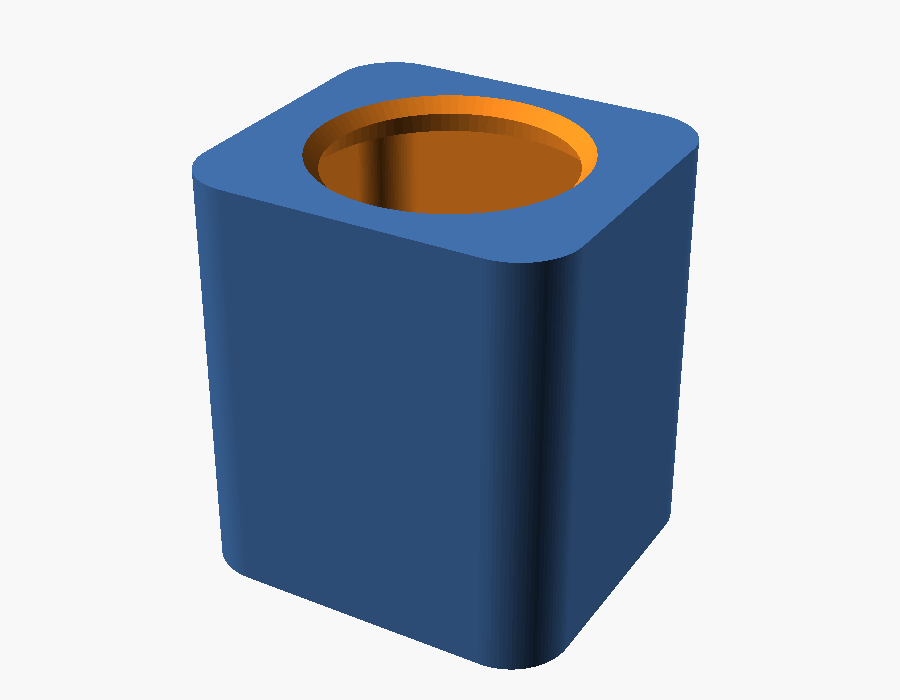

# Capa para Owlset HEIM ES X-NANO XPD + anel honeycomb de titânio (41 mm)

- `capa_xnano.scad`: modelo paramétrico (OpenSCAD). Todas as medidas estão no topo do ficheiro.
- `capa_xnano.stl`: STL gerado com as medidas **provisórias**. **Não imprima antes de medir o aparelho.**

## Como funciona
1. Coloque o anel de titânio dentro da capa, encostado à frente. Fica no encaixe de 41 mm.
2. Meta o aparelho por trás. A frente do aparelho prende o anel contra o rebordo frontal.
3. A traseira fica aberta para a ocular e o ecrã.

## O que medir (paquímetro)
| Parâmetro | O que é |
|---|---|
| `dev_w`, `dev_h`, `dev_l` | largura, altura e comprimento do corpo |
| `dev_r` | raio dos cantos |
| `lens_dx`, `lens_dz` | desvio do centro da lente em relação ao centro do corpo |
| `ring_t` | espessura do anel de titânio |
| `ring_open_d` | diâmetro da abertura interior do anel |
| `top_cutouts`, `side_cutouts` | posição dos botões, da porta USB e do compartimento da pilha |

## Impressão
- Material: **TPU 95A** (capa flexível que absorve impactos e entra à pressão) ou PETG/ASA (rígida, nesse caso use `back_lip = 0`).
- Imprimir com a frente na mesa. Não precisa de suportes.
- Camada de 0,2 mm, 3 perímetros, 25–40 % de enchimento.
- Imprima primeiro um teste curto (`cover_len = 15`) para confirmar o encaixe.
