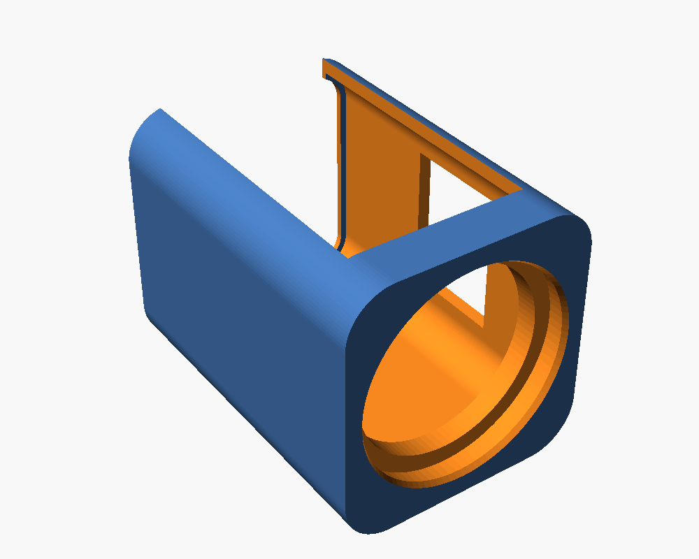

# Capa para Owlset HEIM ES X-NANO XPD + anel honeycomb de titânio (41 mm)

 

- `capa_xnano.scad`: modelo paramétrico (OpenSCAD). Todas as medidas estão no topo do ficheiro.
- `capa_xnano.stl`: STL gerado com as medidas **provisórias**. **Não imprima antes de medir o aparelho.**

## Como funciona
Frente, da face para trás: aba de retenção de 1 mm → encaixe do anel (4 mm) → **espaçador de 4 mm** → aparelho.
1. Encaixe o anel de titânio **pela frente**. Em TPU, a aba cede e o anel "clica" para o lugar.
2. Meta o aparelho por trás até encostar ao espaçador. O honeycomb fica a 4 mm da lente.
3. A traseira fica aberta para a ocular e o ecrã. A base está aberta para o rail.
4. A janela dos botões fica do lado direito (visto por trás).

Medidas atuais: corpo de 41 × 42 mm. Os 60 mm medidos a partir da face incluem 5 mm de frente, por isso o aparelho tem 55 mm.
Capa por fora: 46,6 × 47,6 × 64,4 mm.

## O que medir (paquímetro)
| Parâmetro | O que é |
|---|---|
| `dev_w`, `dev_h`, `dev_l` | largura, altura e comprimento do corpo (já medidos: 41 × 42 × 60) |
| `dev_r` | raio dos cantos |
| `lens_dx`, `lens_dz` | desvio do centro da lente em relação ao centro do corpo |
| `ring_t` | espessura do anel de titânio |
| `ring_open_d` | diâmetro da abertura interior do anel |
| `buttons_side`, `btn_y1..btn_z2` | janela dos botões (já medida: lado direito (visto por trás), 18,1–35,5 mm da frente, 9,5–33,8 mm do topo) |
| `bottom_slot_w` | largura da abertura de baixo para o rail (33 mm) |

## Impressão
- Material: **TPU 95A** (capa flexível que absorve impactos e entra à pressão) ou PETG/ASA (rígida, nesse caso use `back_lip = 0`).
- Imprimir com a frente na mesa. Não precisa de suportes.
- Camada de 0,2 mm, 3 perímetros, 25–40 % de enchimento.
- Imprima primeiro um teste curto (`cover_len = 15`) para confirmar o encaixe.
